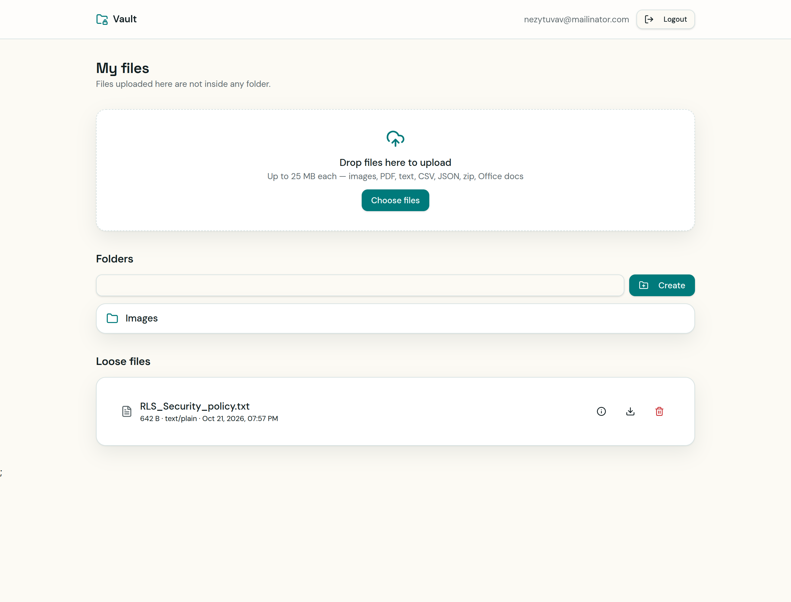

# File Uploader — Full-Stack Application

This is a full-stack file management application that allows authenticated users to upload, organize, and share files through a web interface. The project focuses on building a practical application while exploring the interaction between frontend development, backend APIs, authentication, database design, and cloud file storage.

## Table of contents

- [Overview](#overview)
  - [The challenge](#the-challenge)
  - [Screenshot](#screenshot)
  - [Links](#links)
  - [Built with](#built-with)
  - [What I learned](#what-i-learned)
  - [Continued development](#continued-development)
- [Author](#author)

## Overview

### The challenge

The goal was to build a file management application that supports authenticated access and allows users to manage their files through a web interface.

Users should be able to:

- Register and log in to their accounts.
- Maintain an authenticated session while navigating the application.
- Upload files and store their associated metadata in a PostgreSQL database.
- Organize uploaded files into folders.
- Browse folders and access their contents.
- Share folders through unique shareable links.
- Access shared folders using a share token.
- Enforce authentication on protected API endpoints.
- View a responsive interface across different screen sizes.

### Screenshot

### Links

- Repository URL: [File Uploader on GitHub](https://github.com/nickonyi/file-uploader)
- Live Site URL: [File Uploader](https://file-uploader-4yun.vercel.app/)

### Built with

**Frontend**

- React
- Vite
- React Router
- JavaScript
- CSS / Tailwind CSS, where applicable

**Backend**

- Node.js
- Express.js
- Passport.js
- Express Session
- REST API architecture

**Database and storage**

- PostgreSQL
- Prisma ORM
- Cloud file storage

**Deployment and infrastructure**

- Vercel for frontend deployment
- Environment-based configuration
- HTTPS and cross-origin resource sharing (CORS)

### What I learned

One of the main motivations behind this project was to move beyond building user interfaces and develop a deeper understanding of how the different layers of a web application work together.

**1. Authentication and session management**

I explored how authentication works across the frontend and backend using Passport.js and Express sessions. This helped me understand the difference between authenticating a user and maintaining their authenticated state across multiple HTTP requests.

I also learned about session cookies, cookie security attributes, CORS, and the challenges of maintaining authentication when the frontend and backend are deployed separately.

**2. Database design and Prisma ORM**

I used PostgreSQL to model users, files, folders, and shared folders. Prisma helped me define relationships between these entities and interact with the database through a structured data-access layer.

This project reinforced the importance of foreign keys, unique constraints, indexes, and deletion behavior when designing a relational database. It also highlighted the need to keep the database schema, Prisma schema, and initialization scripts consistent.

**3. Backend architecture and API security**

Building the backend helped me understand how Express middleware, route handlers, authentication checks, and error handling work together to process requests.

I implemented protected API routes to ensure that file and folder operations require authentication. This also reinforced an important security principle: access control must be enforced on the server, rather than relying solely on frontend route protection.

**4. File storage and metadata management**

I learned that storing files involves more than saving their names in a database. The application must manage the actual file storage location alongside metadata such as the original filename, MIME type, file size, ownership, and folder association.

Separating file content from its database metadata provides a clearer architecture and makes file retrieval, organization, and sharing easier to manage.

Overall, this project helped me connect frontend development with the underlying systems that make web applications work, including HTTP, authentication, backend processing, database relationships, and external storage.

### Continued development

My next step is to strengthen the application's reliability, security, and maintainability.

Areas I intend to explore include:

- Improving session management and cookie security across production environments.
- Strengthening authorization checks to ensure users can only access files and folders they are permitted to use.
- Implementing robust file validation, upload limits, and error handling.
- Improving shared-link behavior, including expiration and access control.
- Adding automated tests for authentication, API endpoints, and file operations.
- Improving logging and monitoring to make production issues easier to diagnose.
- Exploring deployment architecture, reverse proxies, environment configuration, and the operational considerations involved in running a production web application.

Beyond adding features, I want to use this project to deepen my understanding of the relationship between software development and systems administration. My goal is to become better at not only building applications, but also understanding, deploying, securing, and maintaining the systems on which they depend.

## Author

- GitHub — [@nickonyi](https://github.com/nickonyi)
- Frontend Mentor — [@nickonyi](https://www.frontendmentor.io/profile/nickonyi)
